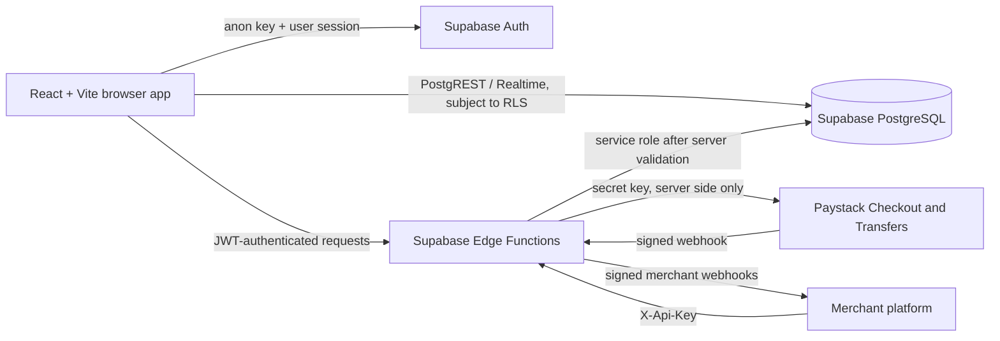

# Architecture

## System overview

## Components and trust boundaries

- **Browser:** React 19, React Router, Vite, and CSS. The Supabase anon key and
  Paystack public key are bundled into the application; neither is a secret.
- **Authentication:** Supabase Auth manages sessions. The UI uses profile role
  data for navigation, but UI role checks are not a security boundary.
- **Database:** PostgreSQL stores profiles, deals, payment metadata, disputes,
  notifications, audit rows, merchants, and merchant API key hashes. RLS is
  enabled, but several policies in the bootstrap schema are broader than the
  intended trust boundaries; see the security findings in
  [`REPOSITORY_AUDIT.md`](./REPOSITORY_AUDIT.md).
- **Edge Functions:** Authenticated consumer operations validate the caller's
  Supabase JWT. Admin functions additionally check the profile role. Merchant
  API functions authenticate a hashed API key. Privileged database operations
  use the service-role key only in the Edge Function environment.
- **Paystack:** The browser uses Paystack's public checkout integration. Payment
  status is verified by signed webhooks or server-side verification. Transfers
  require Paystack account transfer capability and can fail independently of
  application code.
- **Merchant callbacks:** Edge Functions sign outbound merchant webhook bodies
  with HMAC-SHA256. Destination validation and safe payout reservation are
  known areas requiring further review.

## Consumer deal lifecycle

1. A buyer or seller creates a deal in `AWAITING_COUNTERPARTY` and shares its
   join link.
2. `join-deal` assigns the other party and advances it to `AWAITING_PAYMENT`.
3. `paystack-init-payment` initializes a Paystack checkout.
4. `paystack-webhook` (signature verified) or `paystack-verify` advances a
   confirmed payment to `IN_ESCROW`.
5. The buyer confirms delivery through `confirm-delivery`. A database
   reservation and persisted reference protect the consumer payout workflow
   against duplicate transfers.
6. Confirmed transfers end in `COMPLETED`; failed or ambiguous transfers remain
   in a review/reconciliation state. An accepted transfer request is not always
   equivalent to a completed mobile-money settlement.

The separate admin manual payout endpoint does not use this atomic reservation
and remains vulnerable to concurrent duplicate requests; do not treat it as
equivalent to the `confirm-delivery` flow.

## Merchant lifecycle

Merchant Edge Functions accept API keys, create deal/payment records, verify
payments, track shipment, and request fund release. API key hashes are stored
in PostgreSQL; the raw key is returned at creation time. Merchant payout
reservation is not currently atomic, and merchant approval/ownership policies
need database-level hardening before this flow should be treated as safe for
real-money production use. Merchant release currently has no atomic payout
reservation and can initiate duplicate transfers under concurrent requests.

## Data-flow limitations

The browser currently reads shared deal/profile rows directly through
PostgREST. The bootstrap schema's public policies expose more columns and rows
than the UI requires. The browser also performs some deal, dispute, and audit
updates directly. See the audit for a prioritized remediation proposal.
